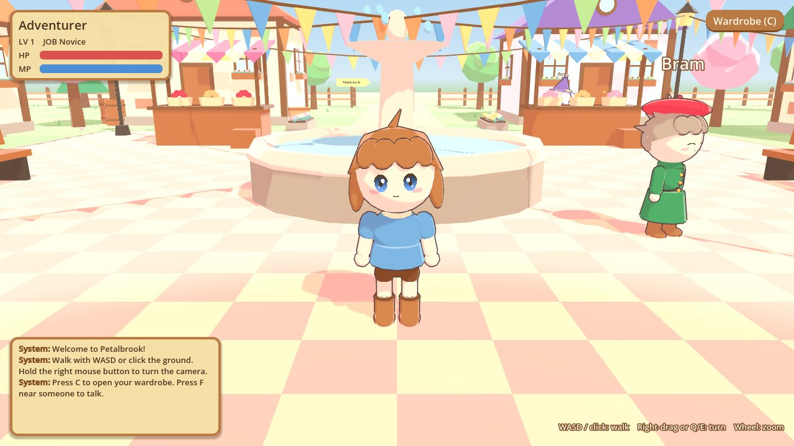
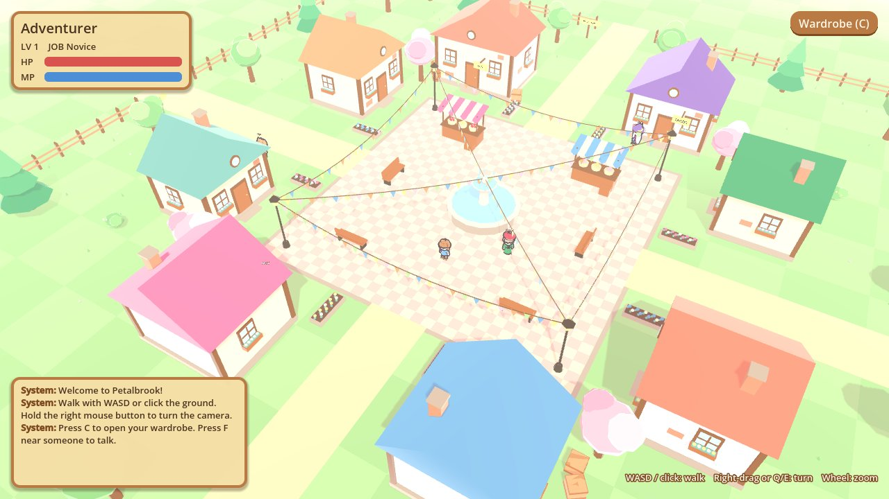
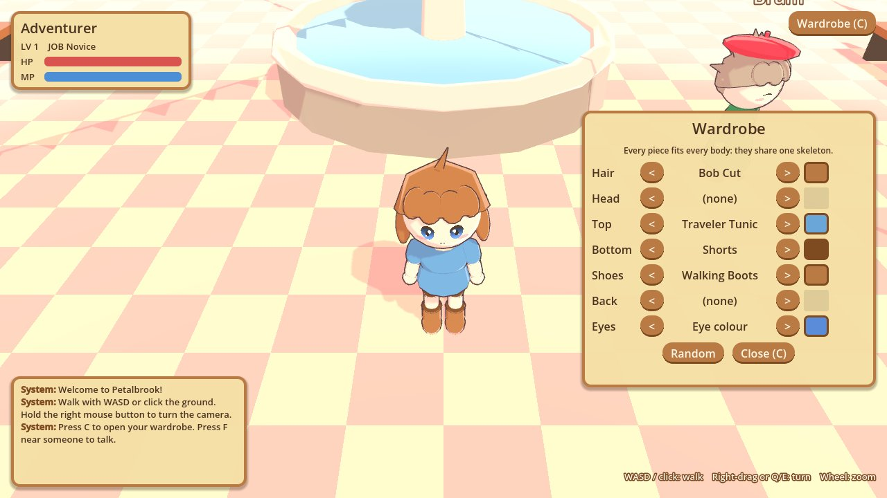
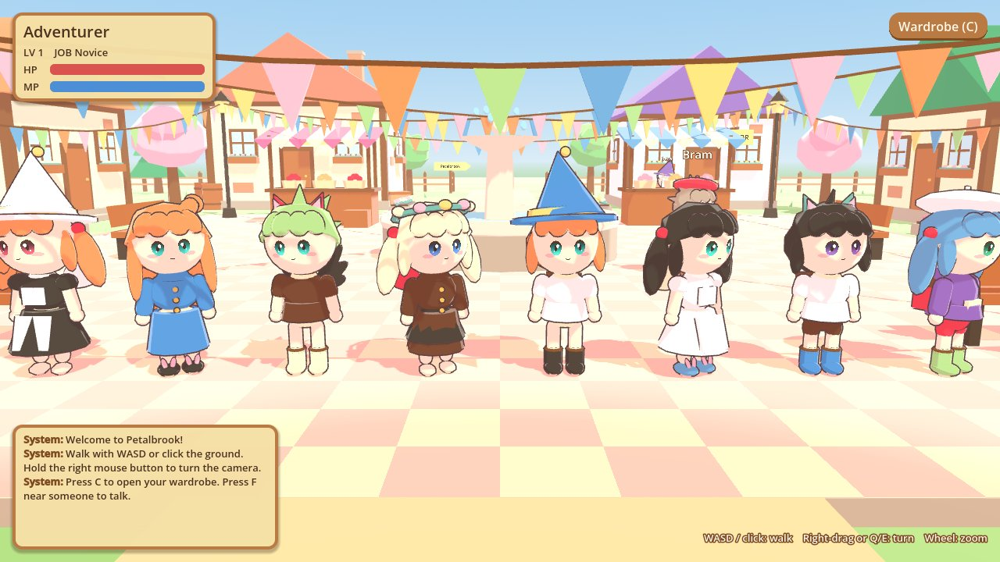
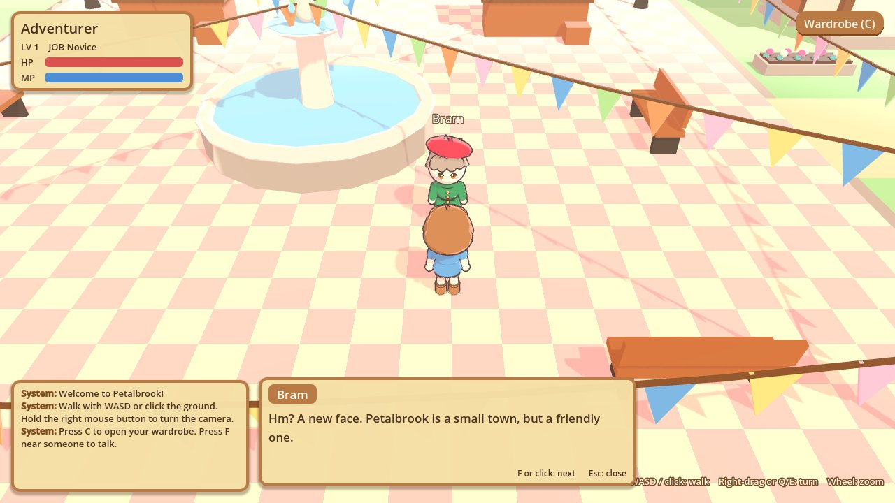

# Petalbrook: MMORPG prototype

The first playable piece of our MMORPG: one cosy pastel town you can walk around in.
It is made in **Godot 4** and aims for the feel of classic anime MMOs like Emil Chronicle Online:
cute 3D chibi characters, soft cel shading, a camera that follows you, and lots of outfits.

All art here is original placeholder art made from simple shapes in code.
Nothing is taken from ECO or any other game.



## What you can do

- Walk around the town with the keyboard, or click the ground to walk there.
- Turn and zoom the camera.
- Talk to four townspeople (Mimi, Bram, Sera and Pip).
- Open the wardrobe and mix hair, hats, tops, bottoms, shoes, back items and colours.

It is single-player for now. Online play comes later.

## How to open and run it (step by step)

1. **Download Godot.** Go to <https://godotengine.org/download> and get **Godot 4.7**
   (the normal version, not the ".NET" one). It is one program, no installer needed.
   On Windows, unzip it and double-click `Godot_v4.7-stable_win64.exe`.
2. **Get this project onto your computer.** On the GitHub page, click the green **Code**
   button, then **Download ZIP**, and unzip it somewhere easy like your Desktop.
   (If you use Git, you can `git clone` it instead.)
3. **Import it into Godot.** In the Godot window that opens (the Project Manager), click
   **Import**, pick the `project.godot` file inside the unzipped folder, then click
   **Import & Edit**.
4. **Wait for the first import.** Godot needs a few seconds to prepare the files the first time.
5. **Press Play.** Click the ▶ button in the top-right corner, or press **F5**.
   The town opens in a new window. Close that window to stop the game.

If Godot asks to "upgrade" or "convert" the project because you have a newer version,
that is fine: click OK.

## Controls

| Action | Keys / mouse |
|---|---|
| Walk | **W A S D** or arrow keys |
| Walk to a spot | **Left click** on the ground |
| Turn the camera | Hold **right mouse button** and drag, or **Q** / **E** |
| Zoom | **Mouse wheel**, or **-** / **=** |
| Talk to someone nearby | **F** or **Space** (again for the next line) |
| Wardrobe | **C**, or the button in the top-right |
| Close a window | **Esc** |

You can change any key in Godot under **Project → Project Settings → Input Map**.

## Screenshots

| The town | The wardrobe |
|---|---|
|  |  |

| Random outfits on the same skeleton | Talking to a townsperson |
|---|---|
|  |  |

## How the project is organised

```
project.godot          Godot's settings (window size, controls, renderer)
scenes/main.tscn       The scene that runs: town + player + townspeople + camera + UI
characters/            The chibi body, the outfit list, the player and the NPCs
world/                 The town, the follow camera, and each kind of building/prop
ui/                    Status window, chat log, dialogue box, wardrobe, and the UI colours
shaders/               The cel (toon) shading, the outline, and the painted-on face
docs/screenshots/      Pictures for this README (Godot ignores this folder)
```

### The characters (`characters/`)

- **`chibi.gd`** builds one chibi character, about 2.5 heads tall. Every character uses the
  **same skeleton** with 7 bones (hips, chest, head, two arms, two legs).
  The body and every piece of clothing are glued to those bones, so when the walk
  animation moves a leg, the trousers and boots move with it.
- **`outfit_catalog.gd`** is the list of every item, grouped into slots:
  hair, head, top, bottom, shoes and back. To make a new item, copy one there,
  give it a new id, and change the shapes and colours. It appears in the wardrobe automatically.
- Outfit rules from our style guide are built in:
  hats hide the top of the hair, dresses hide the bottom slot, and shoes hide bare feet.
  Every item has a **dye** colour you can change.
- The face (eyes, blush, mouth) is painted by `shaders/face.gdshader`, not modelled.
  Characters blink by changing one number.

**Try it in the editor:** open `scenes/main.tscn`, click **NPCs → Mimi → Chibi** in the
Scene panel (left), and change **Hair**, **Top** or a **Dye** in the Inspector (right).
She changes right away.

### The town (`world/`)

Each building and prop has its own little script with settings you can change in the
Inspector: houses (size, wall and roof colour, sign text), trees (round, pine, blossom),
market stalls, lamp posts, flag strings, fences, benches, barrels and flower beds.
Open `world/town.tscn` and drag things around, or duplicate a house with **Ctrl+D**.

### The look (`shaders/`)

- `toon.gdshader` gives the flat "cel" shading: a lit side and a warm, pinkish shadow side
  instead of grey.
- `outline.gdshader` draws the thin dark-brown outline around characters.
- The town uses no outlines so the characters stand out.

## What comes next

These pieces are placeholders on purpose, so they can be swapped one at a time:

1. **Real art.** Make a base body in Blender on the same 7-bone skeleton (or a bigger one),
   then make clothes as separate meshes skinned to it. The slot system stays the same.
2. **Online play.** Add a server (for example Nakama, or Godot's own multiplayer) so
   players can see each other in town.
3. **More places.** The signposts at the town gates point to the fields, the harbour
   and the forest, which don't exist yet.
4. **Steam.** When the game is ready, export it from Godot (**Project → Export**) and
   upload it with Steamworks.

## Notes

- The project uses Godot's **Compatibility** renderer, so it runs on older and cheaper
  PCs too. You can switch to Forward+ in **Project Settings → Rendering → Renderer**.
- The `.godot/` folder is made by Godot on your computer and is not saved to Git.
