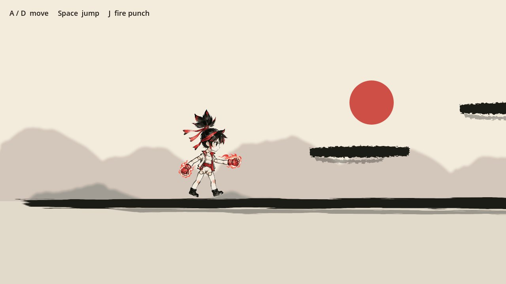

# Ink Seal Heroes: 2D prototype

A small test level for the 2D side-scroller version of our MMORPG.
Benika, the fire hero, can run, jump onto brush-stroke platforms and throw a fire punch,
in front of ink-wash mountains on rice paper.



It's a test of the look and the controls only. There are no enemies, no other players and no menus yet.
Benika's body parts were painted with AI (a Higgsfield Seedream "parts sheet") and cut out for the game.
The level art is drawn from code. Nothing is taken from other games. Steam asks you to disclose AI art when you publish.

## How to open and run it

1. **Download Godot 4.7** from <https://godotengine.org/download> (the normal version, not ".NET").
   On Windows, unzip it and double-click `Godot_v4.7-stable_win64.exe`.
2. **Get the project.** On GitHub, click the green **Code** button, then **Download ZIP**, and unzip it.
3. **Import it.** In Godot's Project Manager, click **Import** and pick
   **`game2d/project.godot`** (the one inside the `game2d` folder). Then click **Import & Edit**.
4. **Press Play** (the ▶ button in the top-right, or **F5**).

## Controls

| Action | Keys |
|---|---|
| Run | **A** / **D** or the arrow keys |
| Jump (hold for higher) | **Space**, **W** or **Up** |
| Fire punch | **J** or **Z** |

You can jump up through the floating platforms from below and land on top of them.

## How Benika is made: "cut-out" animation

Benika isn't one picture. She's 7 pictures in `art/benika/` (head, ponytail, body,
two arms and two legs), joined at the neck, shoulders and hips like a paper puppet.
`characters/cutout_rig.gd` turns those joints a little every frame to make her
breathe, walk, jump and punch.

That matters for an outfit game. Changing her jacket means swapping one picture
(`torso.png`), and every animation keeps working. With frame-by-frame drawing,
every hat or jacket would have to be redrawn for every frame of every move.

## What's where

```
project.godot            Settings: window size, controls, paper background colour
scenes/main.tscn         The scene that runs: level + player + help text
characters/player.gd     Running, jumping (gravity), the fire punch and its flame splash
characters/cutout_rig.gd The paper-puppet body and its poses (idle, walk, jump, punch)
world/level.gd           The platforms (edit the list to change the level) and mountains
art/                     The painted parts (PNG)
tools/                   The scripts that drew the art (Godot ignores this folder)
```

**Try it in the editor:** select **Level** in `scenes/main.tscn` and edit **Platforms** in the
Inspector. Each entry is a platform's x, y and width. The first one is the ground.

## The art

Benika's 7 parts come from one AI-painted sheet (head, ponytail, body, two arms, two legs on white paper).
The white was removed, each part was cut out and shrunk, and the ponytail painted on the head was erased
so the separate ponytail can swing at its hair tie.

To use a new painting for a part, save it as a PNG with a see-through background and the same name in
`art/benika/`. If its size or shape changes, fix that part's `pos` (where the joint sits) and `offset`
(where the joint is inside the picture) in `PARTS` in `characters/cutout_rig.gd`.

The old placeholder parts were drawn from SVG by `tools/make_art.js` and `tools/trim_art.py`.
Don't run those now: they would overwrite the painted parts.

## What could come next

1. Turn the other five heroes (Mizuha, Iwao, Kazane, Akari, Yoru) into cut-out parts.
2. A practice dummy or a slime to punch, with damage numbers.
3. A dress-up screen that swaps parts (hats, jackets) and dye colours.
4. Online play, so players see each other in the same level.
